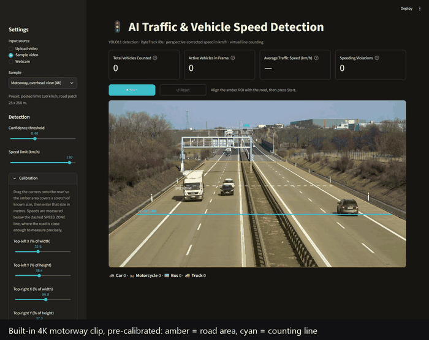

# AI Traffic & Vehicle Speed Detection

A live Streamlit demo that finds vehicles in traffic video, follows each one with a persistent ID,
measures its speed in km/h and flags speeding. Detection is **YOLO11** (`yolo11n.pt`, COCO weights),
tracking is **ByteTrack**, detections and drawing use **Supervision**, and the road geometry uses **OpenCV**.

| Box colour | Meaning |
| --- | --- |
| Green | Car or motorcycle at or under the speed limit |
| Blue | Bus or truck at or under the speed limit |
| Red | Any vehicle above the speed limit (it stays red once it has been flagged) |

Every box is labelled `#ID | Class | Speed km/h` and drags a fading trail behind it. A virtual line
counts each vehicle once as it crosses, per class.

## Demo

[](docs/demo.mp4)

Click the preview for the full-quality video (37 s). It shows the built-in sample clip, then **Start**,
then the speed-limit slider being moved while the video plays (vehicles above the limit turn red), and
finally **Pause** with the vehicle log ready to download as CSV. It was recorded from the real app on an
RTX 4050 laptop GPU. The 4K clip plays at roughly half speed because decoding it caps the app at about
12 frames per second, as the status line shows. The footage is Roboflow's Supervision demo video.

## Quick start

```bash
python -m venv .venv
.venv\Scripts\activate            # Windows (macOS / Linux: source .venv/bin/activate)
pip install -r requirements.txt
streamlit run app.py
```

If PowerShell refuses to run `Activate.ps1`, skip the activation and call the venv directly:
`.venv\Scripts\python -m pip install -r requirements.txt`, then `.venv\Scripts\python -m streamlit run app.py`.

The first start downloads `yolo11n.pt` (about 6 MB). The first time you pick the built-in sample it
downloads a 35 MB clip into `samples/`. After that the app works offline.

**NVIDIA GPU (optional).** On Windows `pip install` gives you a CPU build of PyTorch. For a GPU, install
the CUDA build *before* the requirements, and the app picks it up automatically:

```bash
pip install torch torchvision --index-url https://download.pytorch.org/whl/cu126
pip install -r requirements.txt
```

## Using the demo

1. **Pick a source** in the sidebar: upload an `.mp4` / `.avi`, use the built-in sample, or use a webcam
   (a camera on the machine that runs Streamlit).
2. **Calibrate** (see below). The preview shows the first frame with the amber ROI, the counting line and
   the dashed *speed zone* line.
3. Set the **confidence threshold** and **speed limit**, then press **Start**. Sliders can be changed while
   the video plays. The **CSV log** can be downloaded at any time.

The built-in sample is a motorway seen from a gantry. Its preset carries the road's posted limit
(130 km/h) and a calibrated road patch of 25 x 250 m. Uploads and the webcam start at 80 km/h and a
generic ROI that you are expected to adjust.

### Calibrating your own video

Speed in km/h is only as good as the calibration. You tell the app which patch of road you are looking
at and how big it really is:

1. Drag the four corner sliders until the amber quadrilateral lies flat on the road: the long edges along
   lane lines or kerbs, the short edges across the road.
2. Enter the real **width** and **length** of that patch in metres. Use something you can measure: a
   map, or road markings of known size.
3. Tick **Show metric grid**. The lines are equally spaced on the real road, so they should look like
   evenly spaced rungs of a ladder. Lane-marking dashes and known landmarks should line up with them.

**Where speeds are measured.** Far from the camera one pixel covers many metres of road, so a one-pixel
wobble of a box would show up as a speed error of tens of km/h. The app therefore reports speed only
where one pixel covers at most 0.75 m of road, which is below the dashed **SPEED ZONE** line. Vehicles
above it are still tracked and boxed (`-- km/h`). On the sample clip, a vehicle's readings scattered
around its own typical speed by a median of 1-3 km/h below that threshold and by 9-19 km/h beyond 1 m/px. If no part of your ROI qualifies, the app
says so: move the far edge of the ROI nearer the camera or use a higher-resolution video.

Only vehicles whose ground point (bottom centre of the box) is inside the ROI are tracked and measured.
A box cut off by the frame edge is skipped, because its ground point is not real.

## How it works

1. **Detect.** YOLO11 runs on each frame, restricted to the COCO classes car (2), motorcycle (3), bus (5)
   and truck (7). Frames wider than 1280 px (4K, for example) are scaled down first.
2. **Track.** ByteTrack (the Ultralytics implementation) assigns IDs. The confidence slider is the level a
   detection needs to *start* a track; weaker detections (down to 0.10) can still extend a track that
   already exists, which keeps IDs stable. A vehicle's class is the majority vote over its lifetime, so
   a car/truck flicker does not change its label or colour.
3. **Map to metres.** `cv2.getPerspectiveTransform` maps the ROI corners to a `width x length` rectangle
   in metres. Each vehicle's ground point goes through that map, so distances are real distances on the
   road whatever the camera angle.
4. **Speed.** Each vehicle keeps a rolling buffer of its last N positions with timestamps (the *speed
   smoothing buffer*, 10 frames by default). Speed is the least-squares slope of position over time,
   not the jumpy frame-to-frame difference, averaged over the last few estimates. The first 6 frames of a
   new track are ignored because a newly found box is unreliable. Files are timed from frame number and
   video FPS, so results do not depend on how fast your machine is; webcam frames are timed when they
   arrive from the camera, and only the newest frame is ever processed.
5. **Violations.** A vehicle counts as speeding when its speed stays above the limit for three
   consecutive estimates, so one noisy frame cannot create a violation. Changing the limit re-evaluates
   every vehicle.
6. **Count.** A horizontal line inside the ROI counts a vehicle the first time its ground point crosses it.

Raising the smoothing buffer to 15-20 frames trades about a quarter of a second of lag for roughly half
the noise near the far end of the speed zone.

### KPI cards

| Card | Definition |
| --- | --- |
| Total Vehicles Counted | Vehicles that crossed the counting line |
| Active Vehicles in Frame | Tracked vehicles currently inside the ROI |
| Average Traffic Speed (km/h) | Mean of each measured vehicle's own average speed |
| Speeding Violations | Vehicles above the limit for three consecutive estimates |

### CSV log

One row per vehicle that was measured or counted:

| Column | Meaning |
| --- | --- |
| `vehicle_id` | ByteTrack ID |
| `vehicle_type` | Car, Motorcycle, Bus or Truck |
| `detected_at` | Run start time plus the video time of first sighting |
| `first_seen_s`, `last_seen_s` | Video time in seconds |
| `crossed_line_s` | Video time it crossed the counting line (empty if it never did) |
| `max_speed_kmh` | Highest speed held for three consecutive estimates |
| `avg_speed_kmh` | Mean speed while measured |
| `speeding` | Whether `max_speed_kmh` is above the limit |
| `speed_limit_kmh` | The limit in force when the file was made |

## What was checked

Tested on Windows 11 with Python 3.14.5, Ultralytics 8.4.214, Supervision 0.31.7, Streamlit 1.67,
OpenCV 5.0 and a CPU build of PyTorch 2.15.

- `python -m pytest tests` runs 32 tests (`pip install pytest` first). They use a synthetic pinhole
  camera with known speeds, so no weights or video are needed. They cover the perspective map, speed
  recovery within 1 % without noise, timing from the clock rather than the frame count, line crossing,
  colour coding, the speed zone and the camera reader.
- On the built-in sample the app counts 10 vehicles (8 cars, 2 trucks). Measured speeds are plausible for
  a 130 km/h motorway: cars between about 96 and 144 km/h, the two trucks between 86 and 89 km/h. There is
  no radar ground truth for that clip, so treat absolute accuracy as unverified.
- On a laptop CPU the sample runs at roughly 7-11 frames per second end to end. Memory stays flat over a
  full playback.
- With the CUDA build of PyTorch (2.14.1, `cu126`) the app runs on an RTX 4050 laptop GPU: detection
  takes about 27 ms per frame against 106 ms on the CPU. The sample is 4K, so decoding it (about 33 ms per
  frame) then limits the whole pipeline to roughly 10-12 frames per second. Installing the CUDA build first
  and the requirements second leaves the CUDA build in place, and the tests also pass there.
- Not tried: a real webcam (the camera reader is tested with a fake camera, and a missing camera gives a
  clear error), and Python versions other than 3.14.

This is a demo of the technique, not a certified speed-enforcement device.

## Licences and the sample clip

Ultralytics YOLO11 is licensed under AGPL-3.0. If you run this as a service for other people you must
publish your source under the same licence or buy an Ultralytics enterprise licence. The sample clip is
the `vehicles.mp4` demo video that Roboflow publishes for Supervision. The clip itself is downloaded on
first use and is not stored in this repository, but the capture in `docs/` shows frames of it, so check
its terms before reusing that capture.

## Project layout

```text
app.py             Streamlit UI: sources, calibration controls, live dashboard, CSV download
detector.py        Detection, tracking, perspective transform, speed, counting, drawing (no Streamlit)
requirements.txt
tests/             pytest suite for the geometry, speed, counting, camera and pipeline logic
.streamlit/        Upload limit (1 GB) and theme
docs/              Demo capture (MP4, plus a GIF preview used by this README)
samples/           Sample clip, downloaded on first use
```
